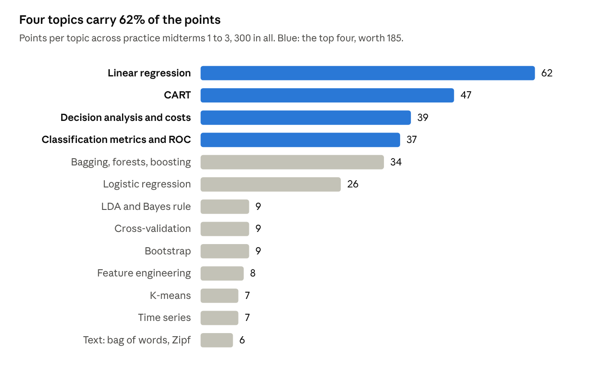
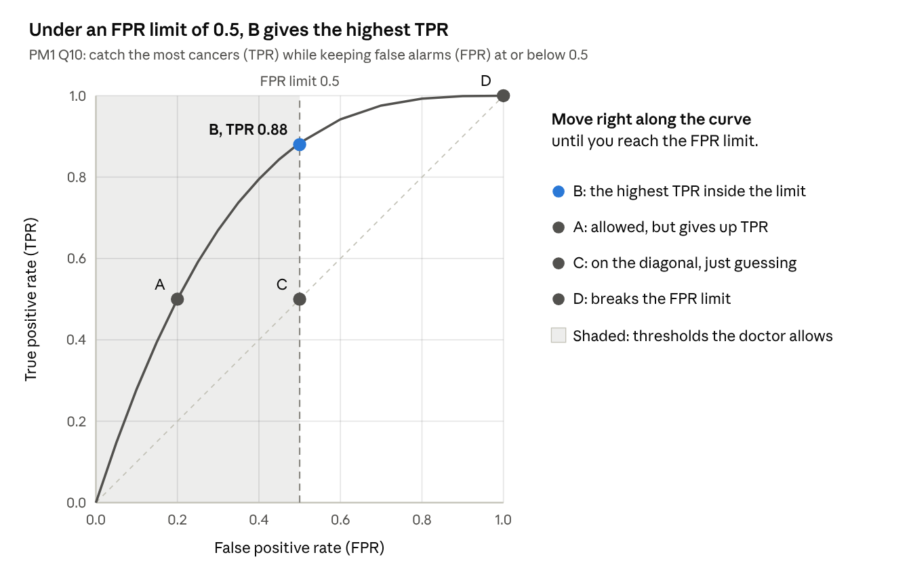
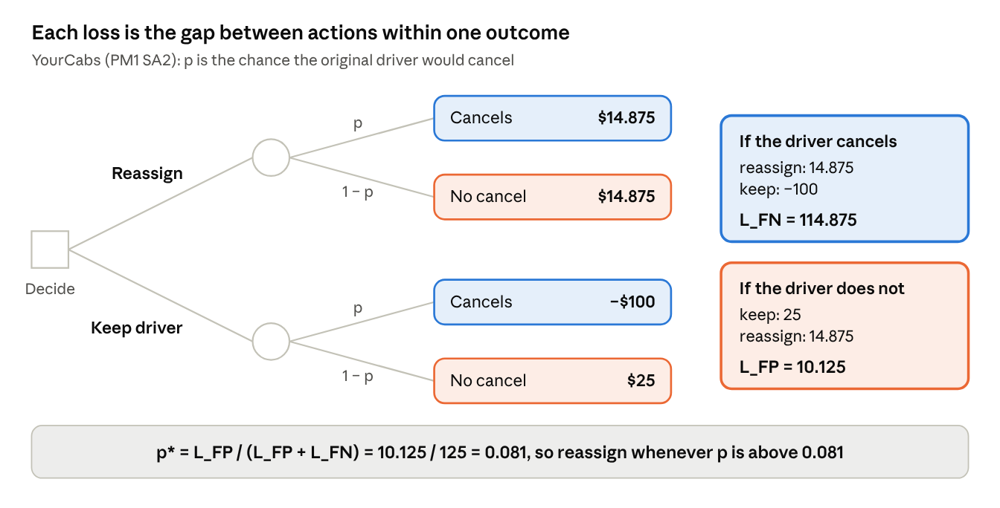
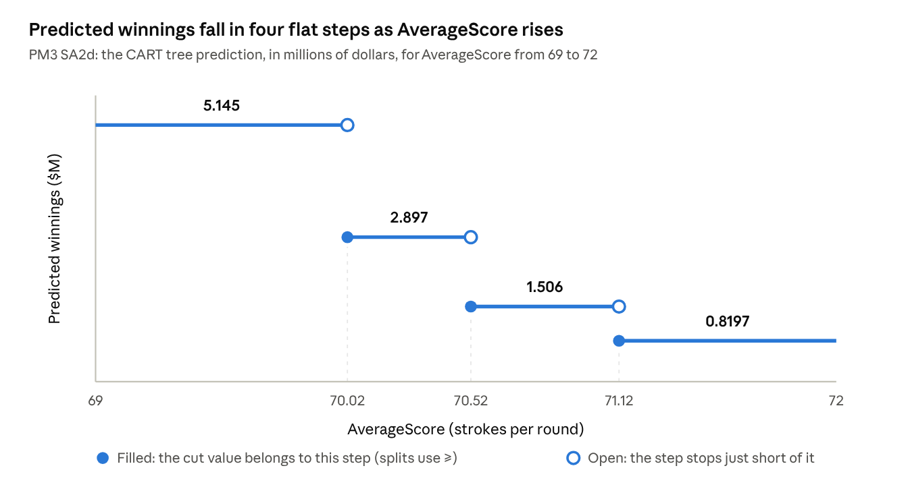

# IEOR 142A Midterm Study Guide

Oct 18, 2026

## Start here: what the midterm tests

Four topics carry 62% of the points across the three practice midterms: linear regression, CART, decision analysis with costs, and classification metrics. Every exam has the same shape: 45 to 48 points of true/false and multiple choice, then 52 to 55 points of short answers built on one or two datasets and their R output.



Below logistic regression, every topic except feature engineering appeared only as true/false or multiple choice, so a few facts each will cover them.

### How to use this guide

1. Read sections on metrics through smaller topics in order. After each one, redo the exam questions listed under "Tested in" without looking at the key.
2. Work the practice problems under a timer, then grade them with the answers section. Each answer names the rule it uses.
3. Build your note sheet from the cheat-sheet blueprint at the end. Then take one blank practice midterm start to finish, using only that sheet.

### Exam rules worth planning around

- You get one double-sided 8.5 × 11 note sheet and a simple calculator.
- Numeric answers can stay as expressions, such as 1/(1 + e^2.3394). Use that if your calculator has no e^x key.
- Short answers are graded on reasoning. Give the answer first, then the evidence: a p-value, a VIF, a count, a payoff.

Shorthand used below: PM1 MC7 means Practice Midterm 1, multiple-choice question 7. PM2 SA3d means Practice Midterm 2, short-answer question 3(d).

These exams are from Spring 2021. Check this term's syllabus for any topic they skip.

## Classification metrics and ROC curves

Every classification metric is a ratio of four counts from the confusion matrix. Get the table right and the rest is division.

Tested in: PM1 MC1, MC2, MC10, MC11, SA1, SA3d · PM2 MC15 · PM3 MC8, MC9, MC12.

### The confusion matrix

|  | Predicted negative | Predicted positive |
| --- | --- | --- |
| Actually negative | TN | FP |
| Actually positive | FN | TP |

```latex
\text{Accuracy}=\frac{TP+TN}{N}\qquad \text{TPR}=\frac{TP}{TP+FN}\qquad \text{FPR}=\frac{FP}{FP+TN}
```

TPR only looks at the actual positives (bottom row). FPR only looks at the actual negatives (top row). TNR = 1 − FPR and FNR = 1 − TPR.

Accuracy is an average of TPR and TNR, weighted by class size. This identity is PM3 MC12 (True):

```latex
\text{Accuracy}=\frac{N_{pos}\cdot TPR+N_{neg}\cdot(1-FPR)}{N_{pos}+N_{neg}}
```

With 35 positives out of 1,013, accuracy is about 97% TNR and 3% TPR. That is why high accuracy says almost nothing about TPR on imbalanced data.

### Baselines and worked numbers

The baseline predicts the training set's majority class for everyone. YourCabs training data has 2,282 non-cancellations and 80 cancellations, so the baseline always predicts "no cancellation" (PM1 SA1).

| YourCabs test set | Accuracy | TPR | FPR |
| --- | --- | --- | --- |
| Baseline: never predict a cancellation | 978/1,013 ≈ 0.965 | 0 | 0 |
| Logistic at threshold 0.081 (TN 909, FP 69, FN 26, TP 9) | 918/1,013 ≈ 0.906 | 9/35 ≈ 0.257 | 69/978 ≈ 0.071 |

The model's accuracy is lower than the baseline's, yet it earns more profit. Accuracy is the wrong yardstick when errors cost different amounts.

### Quick true/false facts

- Accuracy = 1 with both classes present means no false negatives, so TPR = 1 (PM1 MC1: True).
- Accuracy = 0.99 says nothing definite about TPR. If 1 of 100 cases is positive and it is missed, accuracy is 0.99 and TPR is 0 (PM1 MC2: D).
- Accuracy, TPR and FPR all depend on the threshold (PM3 MC8: False). Lowering it predicts more positives, so TPR and FPR both rise.
- Two rows with identical features but different labels mean no classifier can reach 100% accuracy (PM3 MC9: False).

### ROC curves

An ROC curve plots one point per threshold, with FPR on x and TPR on y. Threshold 1 gives (0, 0); threshold 0 gives (1, 1). The diagonal is random guessing.

AUC is the area under the curve: 0.5 is random and 1 is perfect. It equals the chance that a random positive scores higher than a random negative.

Picking a point under a constraint (PM1 MC10):

1. Translate the words into metrics. "Telling a sick patient they're healthy" is a false negative, so minimizing it means maximizing TPR. "Wrongly telling a healthy patient they're sick at most 50% of the time" means FPR ≤ 0.5.
2. On the model's curve, move right as far as the constraint allows. TPR never falls as FPR rises.
3. That lands on B (FPR 0.5, TPR ≈ 0.88). C sits on the baseline, and D breaks the constraint.



The shaded band holds every threshold the doctor accepts. TPR only rises as you move right, so the band's right edge, point B, is the answer.

Comparing two curves (PM2 MC15): a higher AUC does not make a model better at every threshold, because curves can cross. Read both curves over the range you need. For TPR between 0.8 and 0.9, the solid curve gets there at FPR of about 0.27 to 0.30, while the dashed one needs roughly 0.4 to 0.55. So the solid model is strictly better there (C).

### Which shaded area is the FPR? (PM1 MC11)

1. Name the positive class and the side of the threshold that predicts it. Here Y = 1 is positive, and x < 4.3 predicts Y = 1.
2. FPR = the negative class's area on the predicted-positive side, divided by the negative class's whole area. TPR is the same with the positive class.
3. Translate into the labeled regions. A region under both curves counts toward both classes.

| Region | Where it sits | Counts toward |
| --- | --- | --- |
| A | left of 4.3, between the two curves | Y = 1 only |
| B | left of 4.3, under the orange Y = 2 curve | both classes |
| C | right of 4.3, between the two curves | Y = 1 only |
| D | right of 4.3, under both curves | both classes |
| E | right of 4.3, under orange and above blue | Y = 2 only |

Y = 2 (the negative class) has total area B + D + E, and only B sits on the predicted-positive side. So FPR = B/(B + D + E), answer D. Option A, (C + D)/(A + B + C + D), is the FNR and is a decoy.

As a check, FPR = P(X < 4.3 | Y = 2) = Φ(−1.2) ≈ 0.12. The question's "4.35" is a typo; the rule it states uses 4.3.

### Traps

- Taking the baseline from the test set's majority instead of the training set's.
- Dividing FP by the predicted-positive column. FPR divides by the actual negatives.
- Calling high accuracy good on imbalanced data.

## Decision analysis: from payoffs to a threshold

Every practice midterm turns payoffs into a probability threshold p\*. You act (predict positive) exactly when p > p\* = L\_FP / (L\_FP + L\_FN).

Tested in: PM1 MC7, SA2, SA3e, SA4 · PM2 SA3a, SA3d, SA3e · PM3 SA3.



Read each color as one outcome: its loss is how much the better action beats the worse one there. The threshold then follows from the two losses alone.

### The recipe

1. Draw the tree: a square for your choice, a circle for chance, payoffs on the leaves.
2. Write each action's expected payoff as a function of p, the probability of a positive.
3. Set the two equal and solve for p\*. Act when p > p\*.

### The shortcut: losses are regrets

A loss is how much worse the wrong action is than the right one, in the world that actually happens.

```latex
L_{FN}=\text{payoff}(\text{right action}\mid\text{positive})-\text{payoff}(\text{wrong action}\mid\text{positive})
```

```latex
L_{FP}=\text{payoff}(\text{right action}\mid\text{negative})-\text{payoff}(\text{wrong action}\mid\text{negative})
```

```latex
p^{*}=\frac{L_{FP}}{L_{FP}+L_{FN}}
```

Why it works: predicting positive risks a false positive, with expected loss (1 − p) × L\_FP. Predicting negative risks a false negative, with expected loss p × L\_FN. Predict positive when the first is smaller, which is exactly p > p\*.

Scaling both losses by the same number leaves p\* unchanged. That is why PM1 SA4 can use L\_FN = 11.34568 and L\_FP = 1.

| Exam | Positive means | Predict positive means | L\_FN | L\_FP | p\* |
| --- | --- | --- | --- | --- | --- |
| PM1 MC7 | not specified | not specified | 2 | 1 | 1/3 |
| PM1 SA2, YourCabs | driver cancels | reassign the booking | $114.875 | $10.125 | 0.081 |
| PM2 SA3, Lending Club | borrower defaults | don't fund the loan | $4,000 | $1,000 | 0.20 |
| PM3 SA3, golf bet | winnings over $2.5M | take the bet | $50 | $100 | 2/3 |

### Worked: YourCabs (PM1 SA2)

- Reassign: 0.001(−110) + 0.999(15) = 14.875, whatever p is.
- Keep the driver: p(−100) + (1 − p)(25) = 25 − 125p.
- Set them equal: p\* = (25 − 14.875)/125 = 0.081.

Regret check: if the driver would cancel, reassigning beats keeping by 14.875 − (−100) = 114.875. If not, keeping beats reassigning by 25 − 14.875 = 10.125. Divide both by 10.125 to get the CART losses in PM1 SA4.

### Worked: the golf bet (PM3 SA3)

You pay $100 now and get $150 back if he clears $2.5M, so the net is +$50 or −$100. Bet when 50p − 100(1 − p) > 0, which is p > 2/3.

You can't decide yet. The regression predicts his winnings (about $2.64M), not the probability of clearing $2.5M. Build a classifier, such as logistic regression on a new column "Winnings > 2.5", estimate p for this golfer, and bet only if p > 2/3.

For intuition only: actual winnings scatter around the prediction (residual SE ≈ $0.89M). A rough normal approximation puts P(winnings > 2.5) near 0.56, below 2/3. A prediction above the bar is not a probability above the threshold.

### Profit from a confusion matrix (PM1 SA3e)

Multiply each cell's count by its payoff and add. Reassigned bookings use the expected payoff of 14.875.

| Outcome | Count | Payoff each | Total |
| --- | --- | --- | --- |
| Kept, no cancellation | 909 | $25 | $22,725 |
| Kept, cancellation | 26 | −$100 | −$2,600 |
| Reassigned | 69 + 9 = 78 | $14.875 | $1,160.25 |
| All bookings | 1,013 |  | $21,285.25 |

The never-reassign baseline earns 978 × 25 − 35 × 100 = $20,950. The model earns $335 more despite its lower accuracy.

### Why minimizing weighted errors maximizes profit (PM2 SA3a)

For Lending Club, profit = 1,000 × TN − 4,000 × FN. Substitute TN = N\_neg − FP:

```latex
\text{Profit}=1000\,N_{neg}-\left(4000\cdot FN+1000\cdot FP\right)
```

N\_neg is fixed by the data, so maximizing profit is the same as minimizing 4,000 × FN + 1,000 × FP. Hence L\_FN = 4,000 and L\_FP = 1,000. The key's last sentence says "false negative" there; it means false positive.

### Thresholds with ensembles (PM2 SA3d and SA3e)

- Trees trained with equal losses output probabilities. Average the B probabilities, then compare the average with p\* = 0.2.
- Trees trained with L\_FN = 4,000 and L\_FP = 1,000 already include the costs and output 0/1 votes. Take a majority vote at 0.5. Using 0.2 here would count the costs twice.

## Linear regression: reading R output

Linear regression questions are reading exercises. Plug numbers into the coefficient table, cite a p-value or a VIF, and know what adding or removing a variable can and cannot do.

Tested in: PM1 MC3, MC6 · PM2 SA1a to SA1e · PM3 MC2, MC3, MC4, SA1a to SA1f.

### Reading the summary table

| Line in the output | What it means | Use it to |
| --- | --- | --- |
| Estimate | Change in predicted Y for a 1-unit rise in X, others held fixed | Make predictions |
| Std. Error | Uncertainty in the estimate | Spot instability; huge values are a red flag |
| t value | Estimate ÷ Std. Error | Rarely needed directly |
| Pr(>\|t\|) | p-value for the null hypothesis β = 0 | Decide significance: below 0.05 is significant |
| Multiple R-squared | Training R² | Describe training fit only |
| Adjusted R-squared | R² with a penalty per variable | Compare models of different sizes |

### Predictions

ŷ = intercept + the sum of coefficient × value, over every variable in the model. Write the expression first; it earns credit before the arithmetic.

- PM2 SA1a: −28.27 + 0.02895(75) + 0.01806(2,500) + 0.002705(10,000) + 0.6985(30) + 2.906(4) + 0.3732(8) = 81.67.
- PM3 SA1a: 114.161145 − 1.745918(70.50) + 2.192717(1.76) + 0.026401(300) − 0.003636(60) ≈ 2.635, about $2.64M. The key prints 2.6341; the gap is rounding.

Check units against the data preview. DrivingAccuracy enters as 60, not 0.6, because head() shows values like 57.7.

### Significance

Template: "Yes (or no): the p-value is \_\_\_, which is below (or above) 0.05, so we can (or cannot) reject the null hypothesis that the coefficient is 0."

- AverageScore, p = 2.46e−15: significant (PM3 SA1c).
- AveragePutts, p = 0.617: not significant (PM3 SA1d).
- CHMAX, p = 0.179: not significant (PM2 SA1c).

### R² versus OSR²

```latex
R^2=1-\frac{SSE_{train}}{SST_{train}}\qquad OSR^2=1-\frac{\sum_{test}(y_i-\hat y_i)^2}{\sum_{test}(y_i-\bar y_{train})^2}
```

- Adding a variable never lowers training R². Removing one never raises it, but it can leave R² unchanged. So "removing an insignificant variable always decreases training R²" is False (PM3 MC2): "always decreases" is too strong.
- Test OSR² can move either way when you add or remove a variable (PM3 MC3: False). A higher training R² guarantees nothing out of sample (PM1 MC3: False).
- OSR² can be negative. That means the model predicts the test set worse than the training mean does.
- Two points with different x values and no noise fit exactly, so the estimates equal the true coefficients (PM3 MC4: True).

### Multicollinearity and VIF

```latex
VIF_j=\frac{1}{1-R_j^2}
```

R\_j² is the R² from regressing X\_j on all the other X's. A VIF above 5 (some courses say 10) signals high multicollinearity. It inflates standard errors and makes signs unstable; predictions suffer less.

- Exam template (PM2 SA1b, PM3 SA1b): "No high multicollinearity: every VIF is below 5, and the largest is 3.14." A pairwise correlation near 0.8 (MMIN and MMAX) doesn't override that; the VIF is the test.
- Large VIFs can coexist with modest pairwise correlations when one variable is close to a combination of several others (PM1 MC6: True). In a quick simulation, X9 = X1 + … + X8 had pairwise correlations near 0.35 but a VIF near 800.

### Adding new variables

- A linear combination of existing variables cannot help. CHAVG = (CHMIN + CHMAX)/2 and putts per round = 18 × AveragePutts add nothing the model couldn't already build (PM2 SA1d, PM3 SA1e). R would report an NA coefficient because of perfect collinearity.
- A nonlinear transform can help. CACH², log(X) or X1 × X2 add shapes the model couldn't make before (PM2 SA1e).

### Transforming Y (PM3 SA1f)

If Y curves against X and its spread fans out, try log(Y). Pick the version whose scatter looks like a straight band with even spread. For golf, log(Winnings) against AverageScore is close to linear, so choose log(Winnings).

Predict on the log scale, then exponentiate to get dollars back.

### Interpretation trap

A coefficient compares observations with every other variable held fixed. Its sign can differ from the variable's raw correlation with Y.

## Logistic regression and LDA

Logistic regression models the probability that Y = 1 directly. LDA instead models how X is distributed within each class, then flips that around with Bayes' rule.

Tested in: PM1 SA3a to SA3c · PM2 MC1 to MC4, MC9, MC12 · PM3 MC1.

### The model

```latex
P(Y=1\mid X)=\frac{1}{1+e^{-(\beta_0+\beta_1X_1+\cdots+\beta_pX_p)}}
```

Facts the true/false questions test:

- Y itself is 0 or 1, not a probability (PM2 MC1: False).
- Predictions always fall strictly between 0 and 1 (PM2 MC2: True).
- There is no assumption about how X is distributed (PM2 MC3: False). That assumption belongs to LDA.
- The formula above is the model (PM3 MC1: True).

### Predicting a probability (PM1 SA3c)

1. Use only the variables in the model the question names. Model 2 has no VehicleModelId, so "vehicle 65" is a distractor.
2. Compute the linear part: z = −4.6625 + 2.3231(1) + 1.6883(0) = −2.3394.
3. Convert it: p = 1/(1 + e^2.3394) ≈ 0.0879.

Sanity check: z < 0 always means p < 0.5.

### Coefficients as odds

The linear part z is the log-odds, log(p/(1 − p)). So e^β is the factor the odds multiply by for a 1-unit rise in X.

For MobileSiteBooking, e^2.3231 ≈ 10.2. A mobile-site booking has about 10 times the odds of cancellation of an otherwise identical booking made another way.

### Categorical variables (PM1 SA3a)

A factor with K levels becomes K − 1 dummy columns. The missing level (VehicleModelId 10) is the reference, absorbed into the intercept. A 14th dummy would add nothing: all 14 always sum to 1, which is perfectly collinear with the intercept.

### Dropping a variable (PM1 SA3b)

Exam answer: every VehicleModelId coefficient has a p-value near 1, so none is significant.

Go deeper: standard errors near 7,800 are a red flag for separation. Some vehicle models likely had zero cancellations, so their coefficients run off toward infinity and their p-values stop meaning much. AIC actually favors model 1 (644.88 versus 659.63); if a question compares models by AIC, lower wins.

### Thresholds

A probability becomes a prediction only after you compare it with a threshold. Changing the threshold changes accuracy, TPR and FPR (PM3 MC8). The decision analysis section shows how costs set it.

### LDA

- LDA assumes X, given Y = k, is multivariate normal with the same covariance in every class (PM2 MC4: True).
- The priors π\_k are the class shares. Bayes' rule turns them into a posterior:

```latex
P(Y=k\mid X=x)=\frac{\pi_k\,f_k(x)}{\sum_j \pi_j\,f_j(x)}
```

- PM2 MC12 (B): P(pass | 10 hours) = 0.9 f\_pass(10) / \[0.9 f\_pass(10) + 0.1 f\_fail(10)\]. The decoys drop the priors (A), drop the denominator (C), or keep the prior on top only (D).
- Categorical features break the normality assumption, but you can still dummy-code them and train LDA (PM2 MC9: False).
- With two normal classes of equal variance and equal priors, the boundary sits midway between the means. In PM1 MC11 that is (4 + 5.5)/2 = 4.75; the exam's 4.3 is just a chosen cutoff.

### Logistic regression or LDA?

Logistic regression assumes nothing about X, so it is safer when features are far from normal. LDA's stronger assumption pays off when it holds, especially with small samples, and it handles three or more classes naturally.

## CART: trees, splits and cp

CART grows a tree greedily, taking the single best cut available at each node. It then prunes any split that improves the fit by less than cp.

Tested in: PM1 SA4a to SA4c · PM2 MC13, SA3b, SA3c · PM3 MC6, MC15, SA2a to SA2d.

### How a split is chosen (PM3 SA2c)

At each node, CART tries every variable and every cut point. It keeps the cut that lowers impurity the most: Gini or error rate for classification, RSS for regression.

Template: "AverageScore was chosen at every node because, at each of those nodes, its best cut lowered RSS more than any cut on the other three variables." Intuition: it is by far the strongest predictor, with a correlation of −0.76 with Winnings.

### Impurity functions (PM2 MC13, PM3 MC6)

- A good impurity function is 0 for a pure node, highest at a 50/50 mix, and concave (an upside-down bowl).
- Concavity guarantees a split never raises total impurity. The parent's mix is a weighted average of its children's mixes, and a concave function of an average is at least the average of the function.
- Gini, 2p(1 − p), and error rate, min(p, 1 − p), are both concave. In PM2 MC13, B (a tent) and C (a dome) qualify, while A (a dip in the middle) and D (a U) don't. Answer: C.
- The decrease can be exactly zero, for example when both children keep the parent's majority class under error rate. So "strictly decreases after every split" is False (PM3 MC6).

### Reading a tree

- Go left when the node's condition is true ("yes").
- "X < 0.5" on a 0/1 variable means X = 0.
- PM1 SA4c: the tree predicts a cancellation only for VehicleModelId 12 booked on the mobile site (OnlineBooking = 0 and MobileSiteBooking = 1).

When a feature is missing (PM2 SA3b and SA3c):

1. Follow every branch you can't rule out.
2. If all of them end in the same class, that is the answer.
3. If they disagree, name the variable you need and what each value gives.

- FICO 650, inquiries unknown: fewer than 3 inquiries leads to "FICO ≥ 665? no", a bad risk. Three or more is also a bad risk. Bad risk either way.
- 4 inquiries, FICO unknown: FICO ≥ 740 gives a good risk. Below 740, "inquiries < 3? no" gives a bad risk. You need the FICO score.

### Regression trees are step functions (PM3 SA2d)

Each leaf predicts the mean of its training points, so the prediction is flat inside each region and jumps at each cut. A "≥" split puts the boundary value on the right-hand step: a filled dot at the left end of each step, an open dot at its right end.



This is the whole answer to PM3 SA2d: label both axes, draw flat steps at the leaf values, and mark which end of each step is closed.

### cp and the R² bounds (PM3 SA2a and SA2b)

A split survives pruning only if it improves the fit by at least cp. For a regression tree, that means raising training R² by at least cp. A bigger cp gives a smaller tree; cp = 0 keeps everything and overfits.

With R² = 0.704 and cp = 0.01:

- Add one more split: R² lands in \[0.704, 0.714\]. Splits never lower training R², and a gain above 0.01 would have been kept.
- Remove the bottom-right split: R² lands in \[0, 0.694\]. That split was kept, so it added at least 0.01.

### Choosing cp by cross-validation (PM1 SA4a and SA4b)

- By average loss: the lowest value, 0.3617, is tied from cp = 0.001 to 0.011. Pick cp = 0.011, the simplest tree among the ties.
- By accuracy: the highest value, 0.9606, is at cp = 0.040.
- With imbalanced classes and unequal costs, trust the loss criterion. The accuracy pick drifts toward the baseline, a tree that rarely predicts a cancellation.

### Cost-weighted leaves

With L\_FN and L\_FP set, a leaf predicts positive when its share of positives is above L\_FP/(L\_FP + L\_FN). That is the same p\* as in decision analysis, so training with those losses maximizes profit.

### Training accuracy from a region plot (PM3 MC15)

Count the points in each region. A one-point region is always classified correctly. The middle region holds two points whose labels you can't see, so at worst one is wrong: 5/6 ≤ A ≤ 1 (C).

## Cross-validation and the bootstrap

Cross-validation picks a model's settings using only the training data. The bootstrap measures how uncertain a number is by recomputing it on resampled data.

Tested in: PM1 SA4 · PM2 MC5, MC7, MC14, MC16 · PM3 MC7, MC14.

### k-fold cross-validation

1. Split the training set into k folds.
2. For each fold, train on the other k − 1 folds and score on this one.
3. Average the k scores. Repeat for each candidate setting, such as each cp, and keep the best.

- The cost is k model fits per setting, and LOOCV is k = n. With n = 1,000, 10-fold needs 10 fits and LOOCV needs 1,000, so 10-fold is roughly 100 times cheaper (PM2 MC7: True).
- Bigger k costs more, and k = n is LOOCV. But k = 1 is not the validation-set method: one fold leaves nothing to train on. The validation-set method is a single train/validate split (PM3 MC14: A).
- Cross-validation does not make overfitting impossible. Choosing the best of many settings can overfit the CV scores themselves, so keep a test set for the final estimate (PM2 MC5: False).

### The bootstrap

One bootstrap sample draws n rows with replacement from the n you have. Some rows repeat, and about 37% are left out.

Confidence interval for a trained model's metric (PM2 MC14: C):

1. Train once on the training set.
2. Resample the test set B times and recompute the metric on each resample. The model is never retrained.
3. With B = 10,000, that is 10,000 metric calculations (PM3 MC7: True).

```latex
\widehat{\text{bias}}=\frac{1}{B}\sum_{b=1}^{B}\hat\theta^{*}_{b}-\hat\theta \qquad \widehat{SE}=\text{SD}\left(\hat\theta^{*}_{1},\dots,\hat\theta^{*}_{B}\right)
```

For a 95% interval, use the 2.5th and 97.5th percentiles of the B values (the percentile method). If your lecture used the "basic" interval, it is \[2θ̂ − q97.5, 2θ̂ − q2.5\].

### Reading bias estimates across B (PM2 MC16: D)

Random noise in a bootstrap estimate shrinks like 1/√B. Going from B = 10,000 to 1,000,000 should cut the noise about 10 times.

| Estimate | Bias at B = 10,000 | Bias at B = 1,000,000 | Verdict |
| --- | --- | --- | --- |
| OSR² | 0.0300 | 0.0297 | Stable, so the bias is real: biased |
| MAE | 0.223 | 0.00927 | Collapsed toward 0, so it was noise: likely unbiased |

This matches theory. MAE is a plain average, which is unbiased; OSR² is a ratio, which generally is not.

## Bagging, random forests and boosting

Bagging and random forests average many deep trees to cut variance. Boosting adds small trees one at a time, each fixing the current errors, to cut bias.

Tested in: PM1 MC4, MC5, MC8 · PM2 MC6, SA2a, SA2b, SA3d, SA3e · PM3 MC5, MC11, MC13.

|  | Bagging | Random forests | Boosting |
| --- | --- | --- | --- |
| Each tree is trained on | A bootstrap sample | A bootstrap sample, trying a random m of the p features at each split | The full data, fit to the current ensemble's errors |
| Trees | Deep, independent | Deep, independent | Small (few splits), built in sequence |
| Main goal | Lower variance | Lower variance, helped by less correlated trees | Lower bias, learning slowly |
| Runs in parallel? | Yes | Yes (PM1 MC5) | No (PM1 MC5) |
| Overfits with more trees? | No | No (PM3 MC13: B) | Yes, eventually |
| Settings to tune | Number of trees | Number of trees, m (mtry) | Number of trees, shrinkage, splits per tree (PM3 MC5: True) |

### Facts the true/false questions test

- Bagging's main purpose is lowering variance, not estimating out-of-sample error (PM1 MC4: False). Out-of-bag error is a by-product.
- Random forest trees are less correlated because of both the bootstrap and the feature subsets (PM1 MC8: C).
- A random forest with m = p is bagging.
- Boosting works with small trees; very deep trees are not why it works (PM2 MC6: False).
- No method always wins. A linear model can beat a forest out of sample (PM3 MC11: False).
- More boosting rounds or added quadratic terms raise the risk of overfitting. More random forest trees don't, which is why B answers PM3 MC13.

### The buggy-bagging questions (PM2 SA2)

- Bagging that samples without replacement: drawing n of n rows without replacement just reshuffles the training set. Every tree sees the same data, so every tree is identical, and their average is that same tree. Test performance equals CART with cp = 0.
- Random forests with the same bug: the data never changes, but each split still draws a random subset of m < p features. The trees differ, so averaging still cuts variance. Expect performance at least as good as CART with cp = 0 in most cases, often better, but with less gain than a correct random forest.

### Combining the trees' outputs (PM2 SA3d and SA3e)

- Regression trees: average the predictions.
- Probability outputs: average them, then apply the cost threshold p\*.
- 0/1 votes from cost-weighted trees: take the majority at 0.5.

## K-means, time series, text and feature engineering

These four topics drew one or two questions per exam, and each comes down to a few facts.

Tested in: PM1 MC9, MC12, SA5 · PM2 MC8, MC10, MC11 · PM3 MC10.

### K-means (PM1 MC9, PM2 MC8)

- You choose K; the algorithm doesn't. To compare K = 5 through 10, run it once per K, six runs in all (PM1 MC9: C). Then compare the within-cluster sum of squares (look for the elbow) and how interpretable the clusters are.
- The loop: pick random centers, assign each point to its nearest center, move each center to its cluster's mean, and repeat until nothing changes.
- Different random starts can give different clusters (PM2 MC8: True). Run several starts and keep the one with the lowest within-cluster sum of squares.
- Scale the features first, because the method runs on distances.

### Time series (PM1 MC12, PM2 MC10)

| What you see in the plot | Term to add |
| --- | --- |
| A steady drift up or down | Trend: β × t |
| A pattern that repeats each year or week | Seasonality: month or weekday dummies |
| Each day looks like the day before | Autoregression: the previous value as a feature |

- Bike rentals climb over two years, peak every summer and track the previous day, so the answer uses all three (PM1 MC12: D).
- The AR(1) model is below. The exam's version had a time trend β₁t and the previous value with no coefficient, so it is not an AR model (PM2 MC10: False).

```latex
X_t=\beta_0+\beta_1X_{t-1}+\varepsilon_t
```

- Split training and test data by date, never at random.

### Text (PM2 MC11, PM3 MC10)

- Bag of words turns a document into word counts and ignores order. "Paul likes to travel" written twice has counts of 2, so it differs from the single sentence (PM3 MC10: False).
- Zipf's law: the r-th most common word appears about 1/r as often as the most common one. That heavy tail means rare words together make up a large share of text (PM2 MC11: False).
- Typical cleanup: lowercase, strip punctuation, remove stop words, stem, and drop very rare terms.

### Feature engineering (PM1 SA5)

- From one timestamp: day of week, hour, month, or a weekend or holiday flag, coded as dummies.
- From two timestamps: the lead time, such as TripDateTime − BookingDateTime in minutes. The question required at least one feature that uses both.
- Only build features from information you will have when you predict. A timestamp recorded after the outcome would leak the answer.

## Exam playbook: question types and how to beat them

Most questions fall into six types, and recognizing the type tells you what the grader wants.

| Type | Signal words | What to do | Seen in |
| --- | --- | --- | --- |
| Absolute true/false | always, never, must, impossible, guaranteed | Hunt for one counterexample; one is enough to make it False | PM1 MC3 · PM3 MC2, MC3, MC6, MC11 |
| Most definitive statement | strongest, most definitive | Find the tightest range that is guaranteed; reject ranges that need facts you lack | PM1 MC2 · PM3 MC15, SA2a, SA2b |
| Can a new feature help? | is it possible to improve | Linear combination of existing features: no. Nonlinear transform: yes | PM2 SA1d, SA1e · PM3 SA1e |
| Enough information? | decide, bet or classify with something unknown | Trace every branch, or ask whether you need a probability rather than a prediction | PM2 SA3b, SA3c · PM3 SA3 |
| Compute from output | predict, accuracy, profit | Write the expression first, then the number | PM1 SA3c to SA3e · PM2 SA1a · PM3 SA1a |
| Justify a choice | why remove, why log, which cp | Name the evidence with its value: a p-value, a VIF, a CV score, a plot's shape | PM1 SA3b, SA4 · PM3 SA1f |

### Habits for short answers

- Lead with the direct answer (yes, no, or the number), then one line of evidence that quotes the output.
- State which class is positive before any TPR, FPR or threshold work.
- Check units and scales: percentages entered as 60, dollars in thousands, winnings in millions.
- Check which model the question names. PM1 SA3c's model has no vehicle variable.
- For a "not enough information" answer, say exactly what you would build or need, and how you would use it.

## Practice problems

These are new questions in the same styles as the practice midterms. The answers are in the next section, so cover it while you work.

### Part A: true or false, with a one-line reason

- **A1.** A model has TPR = 0.7 and FPR = 0.1 on a test set with 200 positives and 800 negatives. Its accuracy is 0.86.
- **A2.** A random forest that tries all p features at every split (m = p) is the same method as bagging.
- **A3.** Adding a variable to a linear regression can lower its training R².
- **A4.** Adding log(X1) to a linear regression that already contains X1 cannot change its predictions.
- **A5.** A boosting model can overfit if you run too many iterations.
- **A6.** Switching from 10-fold to 5-fold cross-validation roughly doubles the computation.
- **A7.** If two models have the same AUC, they have the same TPR at every FPR.
- **A8.** LDA assumes that, within each class, the features are multivariate normal with a shared covariance matrix.
- **A9.** The bag-of-words vectors of "dog bites man" and "man bites dog" are identical.
- **A10.** To build a bootstrap confidence interval for a trained model's test-set AUC, you retrain the model on each bootstrap sample.
- **A11.** A logistic regression model can output a predicted probability of exactly 0.
- **A12.** P(spam) = 0.3. For one email, f\_spam(x) = 0.5 and f\_ham(x) = 0.2. Then P(spam | x) > 0.5.
- **A13.** Running K-means twice with K = 4 on the same data must give the same clusters.

### Part B: short answer

**B1. Fraud review.** A bank can send a transaction to manual review for $20, and review always catches fraud. An unreviewed fraud costs $500; an unreviewed legitimate transaction costs nothing. Fraud is the positive class.

- (a) Find L\_FN, L\_FP and the threshold p\* for sending a transaction to review.
- (b) On 2,000 test transactions: reviewed and fraud 30, reviewed and legitimate 170, not reviewed and fraud 10, not reviewed and legitimate 1,790. Compute accuracy, TPR and FPR.
- (c) Find the total cost of the model's policy and of the "never review" baseline. What is the baseline's accuracy, and what does the comparison teach?

**B2. Churn.** Y = 1 if a customer leaves. Contract has three levels: month-to-month, one-year and two-year.

```
                   Estimate   Pr(>|z|)
(Intercept)          -1.20    < 2e-16
Tenure (months)      -0.05      1e-08
MonthlyCharge ($)     0.02      3e-05
ContractOneYear      -0.90      2e-06
ContractTwoYear      -1.80    < 2e-16
```

- (a) Why are there only two Contract coefficients?
- (b) Predict P(churn) for tenure 10, monthly charge 80, one-year contract.
- (c) Predict it for the same customer on month-to-month.
- (d) Interpret e^(−1.8) ≈ 0.165.

**B3. House prices.** Price is in $1,000s.

```
              Estimate   Pr(>|t|)   VIF
(Intercept)     52.3      0.001
SqFt             0.112   < 2e-16    4.2
Bedrooms        -4.1      0.21      4.0
Age (years)     -0.85     0.003     1.3
Pool (0/1)      18.6      0.04      1.1
```

- (a) Predict the price of a 1,800 sq ft, 3-bedroom, 20-year-old house with a pool.
- (b) Is there enough evidence that Bedrooms matters? On what do you base that?
- (c) Is multicollinearity severe here?
- (d) Could adding SqMeters = 0.0929 × SqFt improve the model? Could adding Age²?
- (e) Does the negative Bedrooms coefficient mean that adding a bedroom lowers a house's value?

**B4. Reading a tree.** A leaf of 1 means bad risk; 0 means good risk.

```
Income >= 50?
├── yes → Debt >= 20?
│         ├── yes → 1
│         └── no  → 0
└── no  → 1
```

- (a) Income 40, debt unknown: how is this applicant classified?
- (b) Debt 10, income unknown: how is this applicant classified?

**B5. cp bounds.** A regression tree has training R² = 0.62 with cp = 0.02.

- (a) One more split is added to a leaf. What is the most definitive statement about the new training R²?
- (b) A bottom split, whose children are both leaves, is removed instead. Same question.

**B6. Cost-weighted CART.** A tree is trained with L\_FN = 9 and L\_FP = 1.

- (a) A leaf holds 40 training points, 5 of them positive. What does it predict?
- (b) Above what share of positives does a leaf predict positive?

**B7. Choosing cp.** Cross-validation output:

| cp | AvgLoss | Accuracy |
| --- | --- | --- |
| 0.000 | 0.520 | 0.901 |
| 0.005 | 0.488 | 0.905 |
| 0.010 | 0.488 | 0.912 |
| 0.015 | 0.497 | 0.930 |
| 0.020 | 0.531 | 0.941 |

- (a) Which cp does the average-loss criterion pick?
- (b) Which cp does accuracy pick?
- (c) False negatives cost far more than false positives here. Which criterion do you use?

**B8. Bootstrap bias.** A regression model has test MSE 9.61 and test RMSE 3.10. Bootstrap bias estimates:

| B | Bias of MSE | Bias of RMSE |
| --- | --- | --- |
| 2,000 | 0.041 | −0.0215 |
| 200,000 | 0.0038 | −0.0212 |

Which test-set estimate is most likely biased? Explain.

**B9. Ensembles.**

- (a) A classmate's random forest uses m = p. What method is it really?
- (b) Another classmate's bagging code samples n rows from n without replacement, with every tree at cp = 0. How will it compare with CART at cp = 0?
- (c) Which is safest to increase without overfitting: random forest trees, boosting rounds, or the polynomial degree of a regression?

**B10. Normal curves.** Legitimate transactions have a score X \~ N(1.5, 1); frauds have X \~ N(3.5, 1). Fraud is positive, and we flag a transaction when x ≥ 3. Use Φ(0.5) = 0.6915 and Φ(1.5) = 0.9332.

- (a) What is the TPR?
- (b) What is the FPR?
- (c) If the cutoff drops to 2.5, which way do TPR and FPR move?

**B11. Features and time series.** A delivery app records OrderTime, PromisedTime and DeliveredTime, and wants to predict which orders arrive late.

- (a) Give two features, at least one that uses two timestamps.
- (b) Which timestamp must you not use as a feature, and why?
- (c) Daily order volume climbs steadily over three years, spikes every Friday, and each day resembles the day before. Which model terms do you include?

**B12. Enough information?** A plant can replace a motor now for $200. If it isn't replaced and fails this month, the total cost is $500. A regression model predicts the motor's remaining life at 45 days.

- (a) Find p\* for "replace now".
- (b) Can you decide from the 45-day prediction? If not, what do you need, and how do you use it?

## Answers to the practice problems

Check the reasoning, not just the verdict: each answer names the rule it uses.

### Part A

| # | Answer | Why |
| --- | --- | --- |
| A1 | True | (0.7 × 200 + 0.9 × 800)/1,000 = (140 + 720)/1,000 = 0.86 |
| A2 | True | With m = p there is no feature sampling, leaving bootstrap samples plus averaging |
| A3 | False | Training R² never falls when a variable is added |
| A4 | False | log(X1) is a nonlinear function of X1, so the fit can change |
| A5 | True | Boosting keeps fitting training errors; tune the number of rounds by CV |
| A6 | False | 5 fits instead of 10, so about half the work |
| A7 | False | Curves can cross while enclosing the same area |
| A8 | True | That is LDA's model |
| A9 | True | Bag of words ignores word order |
| A10 | False | The model stays fixed; resample the test set and recompute AUC |
| A11 | False | The logistic function never reaches 0 or 1 |
| A12 | True | 0.3 × 0.5 / (0.3 × 0.5 + 0.7 × 0.2) = 0.15/0.29 ≈ 0.52 |
| A13 | False | Random starting centers can end in different local optima |

### Part B

**B1.**

- (a) If fraud: reviewing pays −$20 and not reviewing −$500, so L\_FN = 480. If legitimate: not reviewing pays $0 and reviewing −$20, so L\_FP = 20. p\* = 20/(20 + 480) = 0.04.
- (b) Accuracy = (30 + 1,790)/2,000 = 0.91. TPR = 30/40 = 0.75. FPR = 170/1,960 ≈ 0.087.
- (c) Model: 200 reviews × $20 + 10 missed frauds × $500 = $9,000. Never reviewing: 40 × $500 = $20,000. The baseline's accuracy is 1,960/2,000 = 0.98, higher than the model's 0.91, yet it costs $11,000 more. Accuracy ignores what errors cost.

**B2.**

- (a) Month-to-month is the reference level, absorbed into the intercept. A third dummy would be perfectly collinear with the intercept.
- (b) z = −1.2 − 0.05(10) + 0.02(80) − 0.9 = −1.0, so p = 1/(1 + e^1) ≈ 0.269.
- (c) z = −0.1, so p ≈ 0.475.
- (d) Holding tenure and charge fixed, a two-year contract multiplies the odds of churning by about 0.165 versus month-to-month: roughly 83% lower odds.

**B3.**

- (a) 52.3 + 0.112(1,800) − 4.1(3) − 0.85(20) + 18.6 = 243.2, about $243,200.
- (b) No. Its p-value is 0.21, above 0.05, so we can't reject a zero coefficient.
- (c) No. The largest VIF is 4.2, below 5. SqFt and Bedrooms are related, but not severely.
- (d) SqMeters: no, it is a linear rescaling of SqFt and perfectly collinear. Age²: possibly, because it is nonlinear.
- (e) Not necessarily. The coefficient compares houses of the same square footage, so an extra bedroom means smaller rooms. It isn't significant anyway.

**B4.**

- (a) Bad risk. Income below 50 goes straight to a 1, whatever the debt.
- (b) It depends on income. At 50 or more, debt below 20 gives a good risk; below 50 gives a bad risk. You need the income.

**B5.**

- (a) R² lies in \[0.62, 0.64\]. A split can't lower training R², and a gain above cp would have been kept.
- (b) R² lies in \[0, 0.60\]. The split was kept, so it added at least 0.02.

**B6.**

- (a) The threshold is 1/(1 + 9) = 0.1. This leaf's share is 5/40 = 0.125, above 0.1, so it predicts positive.
- (b) Any share above 10%.

**B7.**

- (a) cp = 0.010. It ties cp = 0.005 at 0.488, and the larger cp gives the simpler tree.
- (b) cp = 0.020, with accuracy 0.941.
- (c) Average loss, because accuracy treats a false negative and a false positive as equally costly.

**B8.** RMSE is most likely biased: its bias estimate holds at about −0.021 while B grows 100-fold. The MSE estimate shrank about 10-fold, which is what noise alone does when B grows 100-fold (√100 = 10). So MSE is most likely unbiased. Theory agrees: MSE is a plain average, while RMSE takes a square root of one.

**B9.**

- (a) Bagging.
- (b) Identical. Every sample is the original data reshuffled, so every tree equals the single CART tree.
- (c) Random forest trees.

**B10.**

- (a) TPR = P(X ≥ 3 | fraud) = P(Z ≥ −0.5) = Φ(0.5) = 0.6915.
- (b) FPR = P(X ≥ 3 | legitimate) = P(Z ≥ 1.5) = 1 − 0.9332 = 0.0668.
- (c) Both rise: a lower cutoff flags more transactions of every kind.

**B11.**

- (a) For example, the hour and day of week of OrderTime (as dummies), and the promised lead time, PromisedTime − OrderTime.
- (b) DeliveredTime. It is only known after the outcome, so it would leak the answer.
- (c) A linear trend, day-of-week dummies for the Friday spike, and the previous day's volume as an autoregressive term.

**B12.**

- (a) Replacing costs $200 for sure; not replacing costs $500 × p in expectation. Replace when 500p > 200, so p\* = 0.4 (L\_FN = 300, L\_FP = 200).
- (b) No. A 45-day prediction is an average, and the motor could still fail this month with a probability above 0.4. Train a classifier, such as logistic regression on "failed within the month", estimate p for this motor, and replace if p > 0.4.

## Practice midterm multiple choice: answers and why

The solution PDFs mark each answer but never say why. Here is a one-line reason for every multiple-choice question, checked against the official keys.

### Practice Midterm 1

| Q | Answer | Why |
| --- | --- | --- |
| 1 | True | Accuracy 1 means no false negatives, so TPR = 1 |
| 2 | D | Missing a lone positive still allows 0.99 accuracy, so TPR can be anything from 0 to 1 |
| 3 | False | Training R² says nothing certain about test OSR² |
| 4 | False | Bagging exists to lower variance |
| 5 | True | Boosting builds on earlier trees; forest trees are independent |
| 6 | True | VIF catches a variable that is a combination of several others, even with modest pairwise correlations |
| 7 | True | p\* = L\_FP/(L\_FP + L\_FN) = 1/3 |
| 8 | C | Bootstrap samples and random feature subsets both decorrelate the trees |
| 9 | C | K is fixed per run, so run once for each K from 5 to 10 |
| 10 | B | Highest TPR with FPR ≤ 0.5 |
| 11 | D | Negatives' area on the predicted-positive side, over all of the negatives' area |
| 12 | D | The plot shows trend, seasonality and day-to-day persistence |

### Practice Midterm 2

| Q | Answer | Why |
| --- | --- | --- |
| 1 | False | Y is 0 or 1; the model outputs the probability |
| 2 | True | The logistic function never reaches 0 or 1 |
| 3 | False | Logistic regression assumes nothing about how X is distributed |
| 4 | True | That is LDA's assumption |
| 5 | False | Model selection can overfit the CV scores; keep a test set |
| 6 | False | Boosting uses small trees |
| 7 | True | 10 fits versus 1,000 |
| 8 | True | Random starting centers |
| 9 | False | Dummy-code the categories; LDA still trains |
| 10 | False | AR(1) is X(t) = β0 + β1 X(t−1) + ε(t) |
| 11 | False | Zipf's tail is heavy, so rare words add up |
| 12 | B | Bayes' rule with priors 0.9 and 0.1 |
| 13 | C | Only concave impurity functions guarantee Δ ≥ 0 |
| 14 | C | Train on the training set, then bootstrap the test set |
| 15 | C | For TPR 0.8 to 0.9 the solid curve needs less FPR; the curves cross elsewhere |
| 16 | D | OSR²'s bias estimate holds steady (real); MAE's shrinks toward 0 (noise) |

### Practice Midterm 3

| Q | Answer | Why |
| --- | --- | --- |
| 1 | True | That is the logistic model |
| 2 | False | Removing a variable can leave training R² unchanged, so "always decreases" is too strong |
| 3 | False | Test OSR² can go either way |
| 4 | True | Two points, two parameters, no noise: an exact and unique fit |
| 5 | True | Splits per tree is a boosting setting tuned by CV |
| 6 | False | Impurity can stay the same after a split |
| 7 | True | One OSR² calculation per bootstrapped test set |
| 8 | False | The threshold moves accuracy |
| 9 | False | The point (5, 5) appears with both labels |
| 10 | False | Bag of words counts repeats |
| 11 | False | No method always wins |
| 12 | True | TP = N\_pos × TPR and TN = N\_neg × (1 − FPR) |
| 13 | B | More forest trees don't overfit |
| 14 | A | k = 1 is not the validation-set method |
| 15 | C | Only the two-point region can hold a mistake |

### Typos in the keys and questions

- PM1 MC11: the threshold is written as 4.35, but the rule uses 4.3.
- PM1 SA3c: the key lists VehicleModelId65 = 1 as a variable, but model 2 has no vehicle variable. Its 0.0879 is still right.
- PM1 SA3d: "926+9" in the key means 9/(26 + 9).
- PM2 MC15: "TRP" means TPR.
- PM2 SA1: the question says five independent variables; the model has six.
- PM2 SA3a: the key's last sentence says "false negative" where it means false positive (L\_FP = 1,000).
- PM3 SA1a: the key prints 2.6341; exact arithmetic gives 2.6352.

## Cheat sheet blueprint (one double-sided page)

Put formulas and decision rules on the sheet, not definitions you already know. Use side 1 for computation and side 2 for reasoning.

### Side 1: formulas and recipes

- The confusion matrix layout (rows actual, columns predicted), with accuracy, TPR, FPR, TNR = 1 − FPR and FNR = 1 − TPR.
- Accuracy = \[N\_pos × TPR + N\_neg × (1 − FPR)\] / N.
- Baseline: the training set's majority class, with TPR 0 and FPR 0 when that class is negative.
- Losses as regrets, p\* = L\_FP/(L\_FP + L\_FN), and the method of setting expected payoffs equal.
- Profit = the sum of count × payoff over the four cells, which equals a constant − (L\_FN × FN + L\_FP × FP).
- Logistic: p = 1/(1 + e^(−z)); e^β is the odds multiplier; z < 0 means p < 0.5. Leave e^x in an expression if your calculator lacks it.
- Bayes and LDA: P(k | x) = π\_k f\_k(x) / Σ π\_j f\_j(x).
- R² and OSR² (OSR² compares against the training mean), and VIF = 1/(1 − R\_j²) with 5 as the line.
- cp bounds: adding a split gives \[R², R² + cp\]; removing a kept bottom split gives \[0, R² − cp\].
- Bootstrap: bias = mean of the B values − the original value; SE = their SD; noise shrinks like 1/√B.
- CV cost: k fits per setting, and LOOCV is n fits.

### Side 2: reasoning rules

- Training R² can't fall when you add a variable or rise when you drop one; OSR² can do anything.
- A linear combination of features adds nothing; a nonlinear transform can.
- Concave impurity means a split never raises total impurity, but it may not lower it either.
- A missing feature in a tree: trace every branch, and if they all end in the same class, that is the answer.
- ROC: under an FPR cap, take the rightmost allowed point. A higher AUC doesn't win at every threshold.
- The ensemble table: what is random, parallel or sequential, whether more trees overfit, and the settings to tune.
- Combining trees: average probabilities, then apply p\*; majority-vote 0/1 outputs at 0.5.
- Bootstrap CI for a trained model: resample the test set and keep the model fixed.
- Time series: trend, seasonality, and AR(1) = β0 + β1 X(t−1) + ε.
- K-means: one run per K, and random starts can differ. Bag of words counts words; Zipf's tail is heavy.
- Enough information? A point prediction is not a probability.
